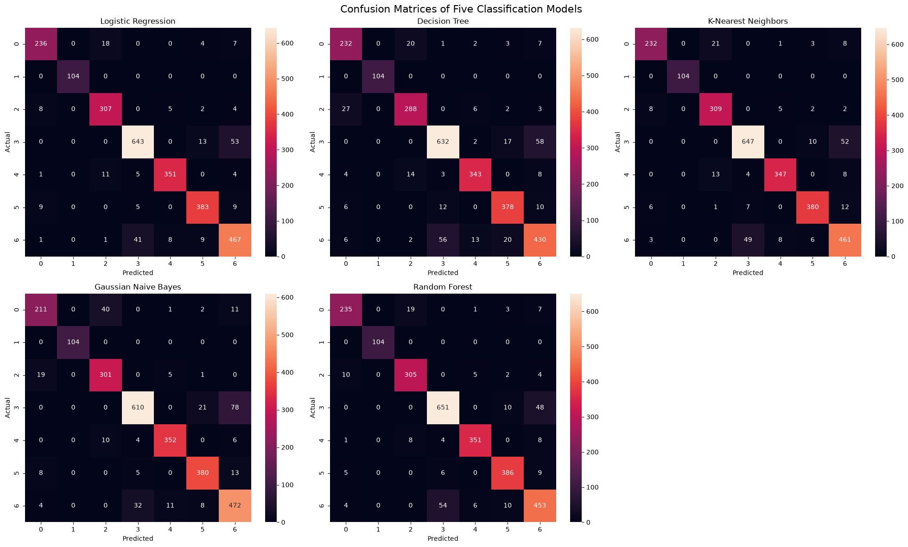
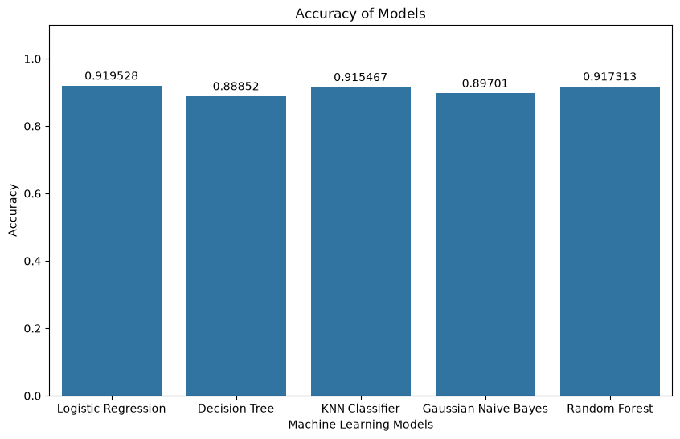
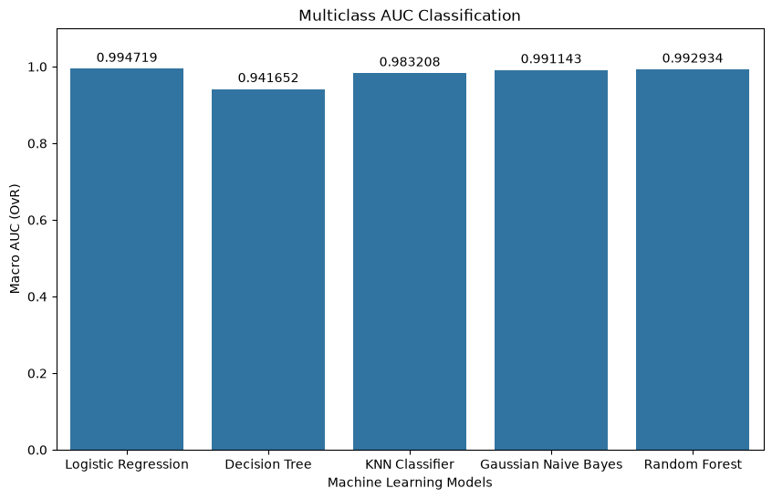
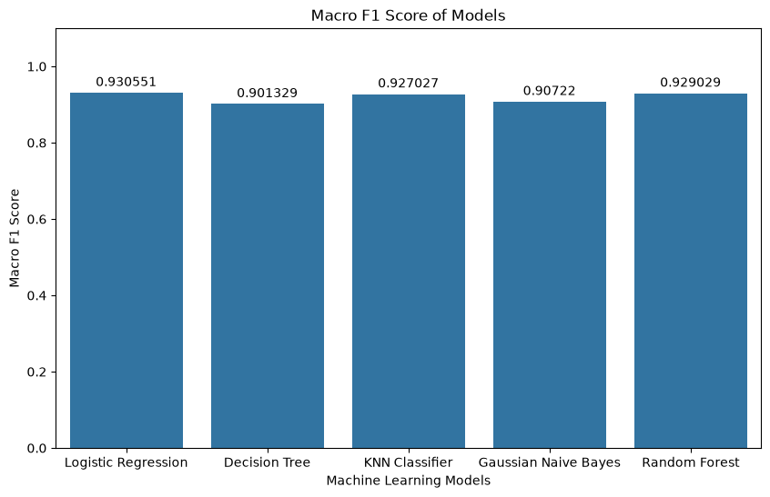
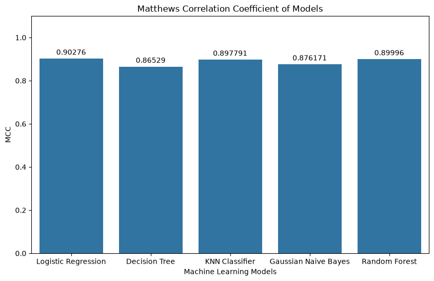

# Dry Bean Variety Classification

## 1. Problem Statement

Predicting 7 different bean varieties from its morphological features (size,shape etc..)
This is mainly helpful for bean seperation and identification in Agriculture and Seperation

## 2. Dataset Description

- **Dataset:** Dry Bean Dataset
- **Source:** [UCI Machine Learning Repository](https://archive.ics.uci.edu/dataset/602/dry+bean+dataset)
- **Original data:** 13,611 rows, 16 numerical input features, and one target column.
- **Used data (Actual Data):** 13,543 rows, 68 duplicate rows have been removed
- **Target:** `Class`, the dry bean variety.
- **Classes:** BARBUNYA, BOMBAY, CALI, DERMASON, HOROZ, SEKER, and SIRA.

The 16 features describe the size and shape of each bean: Area, Perimeter, MajorAxisLength, MinorAxisLength, AspectRation, Eccentricity, ConvexArea, EquivDiameter, Extent, Solidity, roundness, Compactness, ShapeFactor1, ShapeFactor2, ShapeFactor3, and ShapeFactor4.

This dataset meets the assignment requirements. It has more than 12 features and 1,000 rows. It also has seven target classes. The notebook checks the class counts and plots the class distribution.

- **Class Imbalance**: The target variable is **not evenly distributed** across the seven bean varities
- DERMASON has 3,546 instances.
- SIRA has 2,636 instances.
- SEKER has 2,027 instances.
- HOROZ has 1,860 instances.
- CALI has 1,630 instances.
- BARBUNYA has 1,322 instances.
- BOMBAY has 522 instances.

DERMASON is the largest class, while BOMBAY is the smallest.

## 3. GitHub Repository

**Repository URL:** [ML Assignment 2 - Github Repo Link](https://github.com/2026ct05143/ML_Assignment_2).

### Files

```text
ML_Assignment_2/
|-- Dry_Bean_Dataset.csv
|-- README.md
|-- requirements.txt
|-- test_data.csv
|-- test_scaled.csv
`-- models/
    `-- dry_bean_classification.ipynb
```

- `requirements.txt` lists the Python packages.
- `test_data.csv` contains the test features and encoded target labels.
- `test_scaled.csv` contains the scaled test features and target labels.
- `models/dry_bean_classification.ipynb` contains the code, results, and plots.

### Run the Project

Use Python 3 and Jupyter Notebook. Open a terminal in the project folder. Run:

```bash
python -m venv .venv
```

Activate the environment. On Windows PowerShell, run:

```powershell
.\.venv\Scripts\Activate.ps1
```

Install the packages and start Jupyter:

```bash
python -m pip install -r requirements.txt
jupyter notebook
```

Open `models/dry_bean_classification.ipynb`. Run the cells from top to bottom. The notebook reads `Dry_Bean_Dataset.csv` from the project folder. It saves the test CSV files in the same folder.

## 4. Models Used

### Data Preprocessing

The notebook checks for missing values and duplicate rows. It removes duplicate rows. The median imputer handles missing numerical values, if any are present.

All input features are numerical. Feature encoding is not needed. The notebook uses `LabelEncoder` to convert the target labels to integers.

The notebook splits the data into 80% training data and 20% test data. It uses stratification to keep the class proportions similar. It uses `random_state=42` for a repeatable split.

The imputer and scaler are in one pipeline. The pipeline is fitted on the training data only. It transforms the test data. The notebook uses `StandardScaler` to scale the features or normalize features.

### Model Configurations

1. **Logistic Regression:** Scikit-learn default settings. Random state is 42.
2. **Decision Tree:** Entropy criterion, no maximum depth, minimum split size of 2, and random state 42.
3. **K-Nearest Neighbors:** 5 neighbors, uniform weights, and Euclidean distance.
4. **Gaussian Naive Bayes:** Scikit-learn default settings.
5. **Random Forest:** 200 trees, entropy criterion, and random state 42.

### Evaluation Metrics

The notebook reports six metrics for each model. It uses macro averaging for AUC, Precision, Recall, and F1 Score. It uses a one-vs-rest method to calculate multiclass AUC.

### Comparison Table

| ML Model Name            | Accuracy |    AUC | Precision | Recall | F1 Score |    MCC |
| ------------------------ | -------: | -----: | --------: | -----: | -------: | -----: |
| Logistic Regression      |   0.9195 | 0.9947 |    0.9311 | 0.9303 |   0.9306 | 0.9028 |
| Decision Tree            |   0.8885 | 0.9417 |    0.9001 | 0.9028 |   0.9013 | 0.8653 |
| KNN                      |   0.9155 | 0.9832 |    0.9290 | 0.9256 |   0.9270 | 0.8978 |
| Naive Bayes              |   0.8970 | 0.9911 |    0.9081 | 0.9082 |   0.9072 | 0.8762 |
| Random Forest (Ensemble) |   0.9173 | 0.9929 |    0.9305 | 0.9278 |   0.9290 | 0.9000 |

### Graph Representation

The notebook has one graph for each required metric: Accuracy, AUC, Precision, Recall, F1 Score, and MCC.

      

### Model Observations

| ML Model Name                    | Observation                                                                                                                                                                                                                                    |
| -------------------------------- | ---------------------------------------------------------------------------------------------------------------------------------------------------------------------------------------------------------------------------------------------- |
| Logistic Regression              | It has the highest Accuracy, AUC, Precision, Recall, F1 Score, and MCC in this test run mainly 91.95% Accuracy and 0.9306 F1 Score. It has demonstrated well balanced, consistent classification across 7 bean varieties                       |
| Decision Tree                    | It has the lowest scores in this comparison with 88.85% Accuracy and 0.9013 F1 Score. It shows single tree gives lower classification effectiveness on this dataset.                                                                           |
| KNN                              | It has the third-highest Accuracy 91.55% and 0.9270 F1 Score. Its results are close to Logistic Regression and Random Forest. Effective classification on distance related predictions.                                                        |
| Naive Bayes                      | Its AUC is high. Its other scores are lower than those of Logistic Regression, KNN, and Random Forest. On the morphological data’s it’s conditional independence limits performance.                                                           |
| Random Forest (Ensemble)         | Its scores are close to Logistic Regression and KNN. It has second-highest Accuracy – 91.73%, F1 Score – 0.9290, and MCC are slightly lower than Logistic Regression. Ensemble approach gives better classification performance comparatively. |
| Overall Winner for your dataset? | **Logistic Regression** is the best by macro F1 Score. Accuracy (0.9195), macro-AUC (0.9947), F1 Score (0.9306), and MCC (0.9028).                                                                                                             |

It also has the highest MCC, at 0.9028. This result is for one train-test split and best among all the evaluated models.
|
